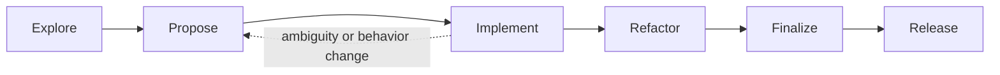

# Lionel's Ada project template — shared agent instructions

This file is the shared instruction reference for Lionel's Ada projects
(bbt, smk, ArchiCheck, TopoProof, and the next ones). It describes
Lionel's process, which is suited to small projects; the process is
simplified by the use of `bbt`, which provides an executable
specification.

Each project's own `AGENTS.md` references this file and keeps only
what is specific to that project, starting from the ready-to-copy
[`project/`](project/) skeleton.

A local exception overrides a shared rule only when it is explicit and
justified.

## How to use this file

In a new project's `AGENTS.md`, start with:

> The shared rules for Lionel's Ada projects live in the [reference
> repository on GitHub](https://github.com/LionelDraghi/ada-project-template/blob/main/AGENTS.md)
> and apply here in full.
>
> **Read it immediately, before any other reading or any action.**

Then keep only the project-specific sections (build pointers, testing
tools, domain rules, conditional readings). Do not copy the shared
sections below into the project: point to them, so that a fix here
applies everywhere.

---

## Non-negotiable rules (shared)

- Never stage, commit, push, tag, create a release or publish to Alire
  without the owner's explicit consent. `git add` is as forbidden as
  `git commit` and `git push`.
- The consent is a separate, explicit approval given by the owner AFTER
  reviewing the diffs. The review is done on the files, before staging:
  present the working-tree diffs, and never stage to have the changes
  reviewed. It may come in a later message. A request in the task
  ("let's push this") states the goal, not the consent. When in doubt,
  wait.
- An explicit "go" for commit or push approves all remaining modified
  files as well.
- If a build, test, documentation, cleanup or publication step fails,
  stop and report the failure.
- Do not include temporary files or test artifacts.
- Check repository cleanliness on the file system, not only with
  `git status`: Git-ignored files (`obj/`, `*.o`, `*.ali`, test
  directories, symlinks rebuilt by the test scenarios...) remain
  invisible to Git.
- Never modify a golden file (`expected_*`, reference output) without
  the owner's agreement.

## Start of every session

1. Read the local `AGENTS.md`.
2. Read this shared file from its current source.
3. Locate the skills available in `.agents`, `~/.agents/skills`, and this repository.
4. Before invoking a skill, read its current `SKILL.md`; never rely on a remembered copy.
5. Determine the current task and lifecycle phase before loading additional context.
6. Load only the documents needed for that phase.

## Local project configuration

Read these values from the local `AGENTS.md`:

- project identity and purpose;
- enabled capabilities;
- build and validation commands;
- project-specific paths or parameters;
- justified exceptions.

Supported common capabilities are:

- bbt executable specifications;
- unit tests;
- SPARK analysis;
- formal proof with GNATprove;
- static analysis and quality metrics;
- release through Alire;
- platform packaging where configured.

A disabled capability is skipped. An enabled capability follows the common rules in this file and its skill. Do not recreate those rules locally.

## Shared lifecycle

Development work, bug fixes and doc updates follow the project's
`docs/dev/development_workflow.md`, which implements this shared
lifecycle. Release versioning, tagging, GitHub release and Alire
publication have a shared procedure instead: it lives in this
repository, `release_procedure.md`, parameterized by each project's
`docs/dev/release_procedure.md`.



`Refactor` is conditional. `Release` is optional and always requires an
explicit user decision.

The detailed lifecycle — phase descriptions, the skill to load in
each, the natural-language triggers, the verification
responsibilities, and the completion criteria per phase — lives in
[`lifecycle.md`](lifecycle.md). Read the phase you are entering, not
the whole file.

## Build pointers (shared)

Every project Makefile is self-documented: `make help` lists all the
targets with a short description, and is the documentation of record —
it shows everything, this file does not duplicate it. The three targets
every phase relies on:

- `make build`: validation-mode build; warnings, including style ones,
  are errors.
- `make check`: run the project's tests.
- `make clean`: remove the build and test artifacts.

A project deviates from these semantics only where the deviation is
explicitly stated in its own `AGENTS.md`.

## State and phase discipline

The working state is one of:

```text
Initial | Exploring | Proposing | Implementing | Refactoring | Finalizing | Releasing
```

Infer it from the user's instruction, current changes, active proposal, and recent validation evidence. Do not create a state file solely to track this value.

- Finish or explicitly suspend current work before selecting unrelated work.
- A return from Implement to Propose is normal when the expected behavior needs correction or clarification.
- Never silently weaken a scenario to make an implementation pass.
- Never move a candidate specification into `docs/features/` before Finalize.
- Never publish, tag, or bump a release version without explicit release intent.

The standard project tree that every project follows is given in the
[README](https://github.com/LionelDraghi/ada-project-template#standard-project-tree);
the documentation structure — responsibilities, naming conventions,
proposal lifecycle, concerns, roadmap and design discussions — is
detailed in [`documentation_structure.md`](documentation_structure.md).

## Reference policy (shared)

References are reading conditions, not a reading list. Never open all
documents up front: identify which document the current task requires,
state why, then read only that one.

Shape each reference as: "To <goal>, read <file>." A project's
`AGENTS.md` must not contain an unconditional "read first" list; if a
document is truly always needed, it belongs in the mandatory rules
instead.

## Semantic tools (shared)

Prefer the MCP language server over grep and hand-counted line edits:
navigate and modify code at the symbol level. With the Serena MCP,
activate the project matching the working directory first.

## Skills (shared)

Load the matching skill before the corresponding work; the lifecycle
annex ([`lifecycle.md`](lifecycle.md)) names the skill to load in each
phase.

All skills are installed with the skills CLI (`npx skills`), for
example `npx skills add LionelDraghi/ada-project-template`:

- The shared lifecycle skills (`explore`, `propose`, `implement`,
  `refactor`, `finalize`, `release`, `next-task`) live in this
  repository, in
  https://github.com/LionelDraghi/ada-project-template/tree/main/skills.
- Third-party skills are installed from their GitHub sources, and stay
  managed by the CLI: `ada-pro` (RREE/Ada-Pro), `gnatprove`
  (adacore/skills), and the **bbt skill** (LionelDraghi/bbt).
- To discover additional skills, use `find-skills`.

## Git discipline

- Inspect status and diff before and after changes.
- Keep unrelated changes in separate commits where possible.
- Do not discard user changes.
- Make commits focused and explain intent.
- Do not force-push, rewrite shared history, publish, or merge without explicit authorization.
- Generated changes must be reproducible from their source and command.
