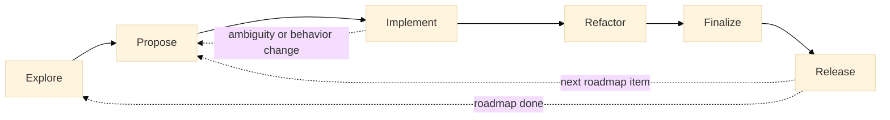

# ada-project-template <!-- omit from toc -->

Shared reference repository for Lionel's Ada projects (bbt, smk,
ArchiCheck, TopoProof, and the next ones).

## Contents <!-- omit from toc -->

- [Design principles](#design-principles)
- [Shared lifecycle](#shared-lifecycle)
- [Repository contents](#repository-contents)
- [Standard project tree](#standard-project-tree)
- [How the projects use it](#how-the-projects-use-it)
- [Skills](#skills)

## Design principles

1. **Common by default.** Process, documentation structure, naming, skills, and validation rules live here.
2. **Local files are declarative.** A project's `AGENTS.md` identifies the project, enables common capabilities, supplies commands, and records genuine exceptions.
3. **Executable specifications first.** Observable behavior is described in Markdown and, whenever applicable, exercised directly with [bbt](https://github.com/LionelDraghi/bbt).
4. **One durable source for each fact.** Index documents point to issues, discussions, specifications, or generated reports instead of copying them.
5. **Explicit phases, limited context.** Each skill loads only the information required for its phase.

## Shared lifecycle

Development follows a shared lifecycle — Explore, Propose,
Implement, Refactor, Finalize, Release — with `Refactor` conditional
and `Release` optional.


The phase details, skills, and state discipline live in [`AGENTS.md`](AGENTS.md) and
[`lifecycle.md`](lifecycle.md).

## Repository contents

```text
ada-project-template/
├── AGENTS.md                    shared agent instructions: non-negotiable
│                                rules, session start, lifecycle schema,
│                                build pointers, state discipline, git
│                                discipline, skills (details in annexes)
├── project/                     the project skeleton, ready to be copied
│                                into a new project: AGENTS.md, README.md
│                                and the whole docs/ tree, with files at
│                                their final names
├── documentation_structure.md   shared docs tree, responsibilities, naming,
│                                proposal lifecycle, concerns, roadmap,
│                                design decisions, changelog
├── release_procedure.md         the common release procedure (10 steps),
│                                parameterized by each project
└── skills/                      shared lifecycle skills: explore, propose,
                                 implement, refactor, finalize, release,
                                 next-task
```

## Standard project tree

Every project follows this layout, stating its deviations in its own
`AGENTS.md`. The `project/` skeleton holds the `AGENTS.md` and `docs/`
parts ready to be duplicated into a new project, with files at their
final names and placeholders to fill in.

```text
<project>/
├── AGENTS.md  README.md  LICENSE  Makefile  alire.toml  <project>.gpr
├── .github/workflows/   build-test.yml; appimage.yml, a continuous
│                        AppImage workflow, when the project ships an
│                        executable; a library publishes no AppImage
├── docs/
│   ├── README.md        the user-facing documentation index
│   ├── changelog.md     the changelog
│   ├── features/        the bbt scenario pages, the executable
│                        documentation: a must-have
│   ├── proposed/        candidate changes awaiting implementation or
│                        integration; see documentation_structure.md
│   ├── tests_results/   the test results and badges, generated and
│                        committed; the tests themselves are not
│                        (necessarily) there
│   └── dev/
│       ├── README.md              this directory's entry point
│       ├── development_workflow.md
│       ├── release_procedure.md   parameters and project additions
│       ├── concerns.md            the shared concerns index
│       ├── design_discussions.md
│       └── fixme_index.md
├── src/                 the sources; the generated src/Alire_config/
│                        is version-controlled
├── tests/               the bbt run directory; may also host optional
│                        suites (sanity/, non_reg/) and the unit tests
└── tools/               the tool sub-projects, when any
```

## How the projects use it

A new project starts by copying the `project/` skeleton: its `AGENTS.md`,
`README.md` and the whole `docs/` tree are ready to duplicate as is,
with files at their final names and placeholders to fill in.

Each project's `AGENTS.md` references this repository on GitHub
instead of duplicating it:

> The shared rules for Lionel's Ada projects live in the [reference
> repository on GitHub](https://github.com/LionelDraghi/ada-project-template/blob/main/AGENTS.md)
> and apply here in full.

Each project's `docs/dev/release_procedure.md` gives the parameter
values and the project-specific additions; the common procedure lives
in `release_procedure.md` here.

## Skills

All skills are installed with the skills CLI (`npx skills`), never by
copying files:

```sh
npx skills add LionelDraghi/ada-project-template
npx skills add RREE/Ada-Pro --skill ada-pro
npx skills add adacore/skills --skill gnatprove
npx skills add LionelDraghi/bbt --skill bbt-skill
```

The shared lifecycle skills live in
https://github.com/LionelDraghi/ada-project-template/tree/main/skills;
the third-party skills stay managed by the CLI, from their GitHub
sources. To discover additional skills, use `find-skills`
(https://github.com/vercel-labs/skills).

Change here, apply everywhere: a fix to a shared rule, to the common
release procedure, or to a shared skill only needs one commit,
and every project picks it up on its next session.
