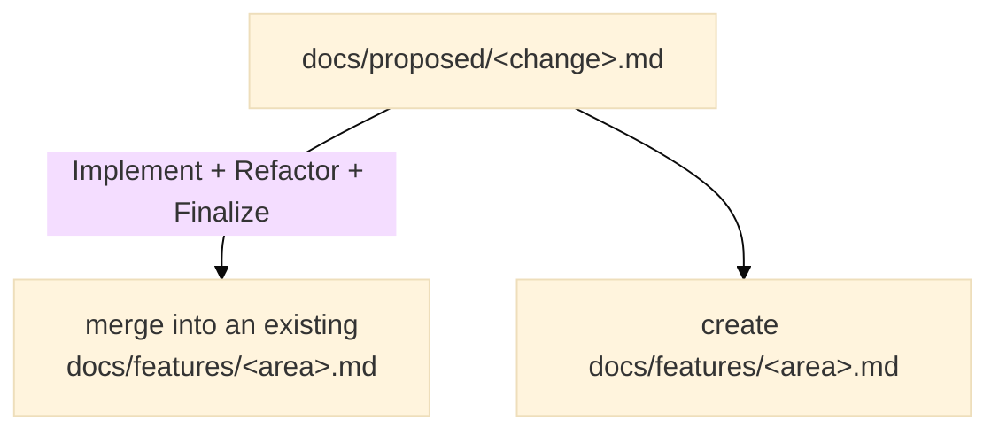

# Shared documentation structure <!-- omit from toc -->

## 1. Standard tree

```text
docs/
├── README.md           the user-facing documentation index
├── changelog.md
├── roadmap.md
├── specifications.md
├── features/
├── proposed/
├── tests_results/
└── dev/
    ├── README.md        this directory's entry point: what each file is for
    ├── development_workflow.md
    ├── release_procedure.md
    ├── concerns.md
    ├── design_discussions.md
    └── fixme_index.md
```

A project may omit an inapplicable file, but must not invent a different name or location for the same responsibility without a documented exception. The reference repository holds this tree instantiated, with files at their final names and placeholders to fill in: copy it from [`project/`](project/) when creating a project. Generated reports keep their existing homes: `docs/tests_results/` for test results and badges, `docs/dev/fixme_index.md` for the fixme index. Other generated reports live under `docs/generated/` when practical, state their generator, and must not be hand-edited.

## 2. Responsibilities

### `docs/README.md`

The user-facing documentation index: a short description of each file
and relative links to them, in the `docs/dev/README.md` style. Its
introduction points to `docs/dev/README.md`, and that one points
back: the two indexes route a lost reader to the right subtree. A
project lists its user guide and its error codes here when it has
them.

### `docs/features/`

The bbt scenario pages: integrated behavioral specifications and durable examples — the executable documentation. Documents may combine explanatory prose with executable bbt scenarios.

### `docs/specifications.md`

The specifications index. It holds the project's cross-feature
specifications — the rules that apply across features, each with a
stable `Snnn` identifier — and the index of the `docs/features/`
pages. The feature pages own every detail: the index may summarise a
feature, but never repeats what the page states; one durable source
per fact.

Feature pages are numbered by a stable scheme with one prefix per
feature series, defined by the project. A number never changes
meaning, a removed scenario is never reused, and pages keep their
number for life. Source code, scenarios, and documents may reference
a specification or feature identifier (e.g. `[S003]`, `[A002-02]`).

### `docs/proposed/`

Candidate changes awaiting implementation or integration. The directory is named by state, not by change type. It may contain:

- new behavior;
- bug corrections;
- robustness improvements;
- incompatible behavior changes;
- executable documentation corrections;
- other changes requiring review before integration.

A proposal may start as prose. Executable scenarios are added when the expected behavior is clear.

### `docs/dev/`

Maintainer-facing documentation: the development workflow, release parameters, unresolved concerns, design decisions, and the generated fixme index. Its `README.md` is the entry point: a short description of each file and relative links to them.

### `docs/tests_results/`, `docs/generated/`

Reproducible reports. Files in these directories state their generator and must not be hand-edited.

## 3. The main README

The main README is the routing page. Its structure:

1. Title, with the `<!-- omit from toc -->` tag, preceded by three
   badges: Made with Ada, with the Ada logo (pointing to
   https://ada-lang.io/), the license badge, and the bbt test results
   badge — a static zero-count badge in the skeleton, replaced by the
   generated `docs/tests_results/badge.svg` after the first bbt run;
2. one sentence stating what the project is and for whom, then one
   paragraph stating the use case it serves — the boilerplate or
   problem it removes;
3. `## Documentation`, organized by role, in this order:
   - *As a curious reader*: the roadmap (or the manifesto when the
     project has one);
   - *As a user*: its index, [`docs/README.md`](project/docs/README.md),
     first, then the notable contents with direct links (user guide,
     error codes, changelog);
   - *As a developer*: its index, [`docs/dev/README.md`](project/docs/dev/README.md),
     first — preceded by the contributing guide when the project has
     one — then the notable contents with direct links (development
     workflow, design discussions);
4. `## How to get it`, before Build and test: the distribution
   channel (Alire crate, release download, AppImage), or build from
   source;
5. `## Build and test`: the build and validation commands;
6. `## Licence`.

The two documentation indexes point to each other in their
introductions, so a lost reader is routed to the right subtree. The
skeleton lives in [`project/README.md`](project/README.md) and
[`project/docs/README.md`](project/docs/README.md).

## 4. Naming conventions

- Use lowercase snake_case file names unless a repository has an established compatible convention.
- Use concise descriptive names: `run_in_shell.md`, not `proposal_2026_10_28.md`.
- Do not encode workflow status in the file name; the directory carries the status.
- Preserve stable identifiers for externally referenced specifications or design decisions.
- Number feature pages and specifications with the stable scheme of
  `docs/specifications.md`; never reuse a freed number.
- Use relative Markdown links inside the repository.

## 5. Proposal lifecycle



A proposal is not always moved unchanged:

- a new independent behavior may be moved or renamed;
- an extension is normally merged into an existing feature document;
- a bug scenario becomes a permanent non-regression scenario in the affected feature;
- a purely structural choice is recorded in design decisions;
- temporary rationale is removed once its durable information has been integrated.

The source proposal is then removed. Git history preserves it.

## 6. Concerns

`docs/dev/concerns.md` is an index, not a duplicate issue tracker. Each row supplies priority, a short label, kind, authoritative link, and status.

Sources include:

- issues and pull requests;
- generated FIXME reports;
- open design decisions;
- failing CI, tests, or proofs;
- known technical debt.

A closed concern is removed or marked closed according to the project's desired history policy. The authoritative source retains the details.

## 7. Roadmap

`docs/roadmap.md` describes intentional future development. It points to proposals, discussions, or specifications. It does not contain low-level defect details.

Priority concerns are considered before roadmap additions when choosing new work, unless the user chooses otherwise.

## 8. Design discussions

`docs/dev/design_discussions.md` records structural choices, alternatives, rationale, and status.

Suggested statuses:

```text
Discussing | Accepted | Rejected | Superseded
```

An open decision may be indexed as a concern when it blocks work or creates material risk.

## 9. Changelog

Use Semantic Versioning and Keep a Changelog conventions. Maintain an Unreleased section. Update it during Finalize when the change matters to users; do not bump a release version until Release.

## 10. Migrations from existing projects

One-shot notes for existing projects adopting this structure:

- bbt's `docs/proposed_features/` is renamed `docs/proposed/`;
- existing per-project concern indexes (bbt's
  `docs/dev/issues_index.md`) migrate into `docs/dev/concerns.md` at
  the next Finalize;
- existing plan documents — a `TDL.md`, `perspectives.md`, or
  `docs/dev/development-plan.md` — converge into `docs/roadmap.md`:
  rename or merge them at the next Finalize;
- `docs/dev/design_discussions.md` is already the name in use in the
  existing projects: no migration is needed.

## 11. Tables of contents

Long documents — roughly more than a screen of sections — carry a
table of contents, in the TopoProof style: a real section, excluded
from the rendered TOC, listing the `##` and `###` headings
(subsections indented):

```markdown
## Contents <!-- omit from toc -->

- [Section](#section)
  - [Subsection](#subsection)
```

It is placed after the introduction, before the first content
heading. Headings that must not appear in a rendered table of
contents are tagged inline with `<!-- omit from toc -->`
(mkdocs-material syntax), as in bbt's feature pages. Every document
carries that tag on its first title:

```markdown
# Document title <!-- omit from toc -->
```
